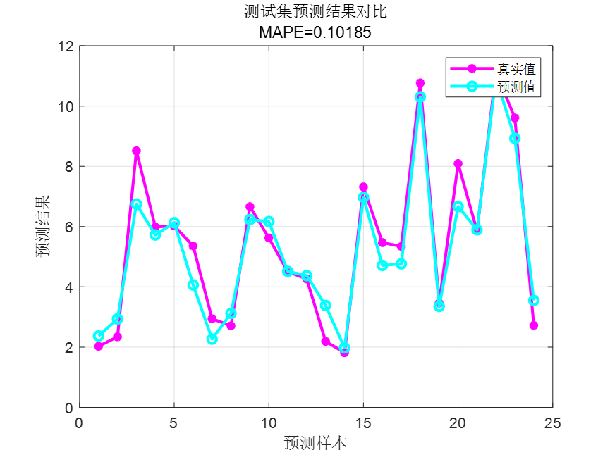
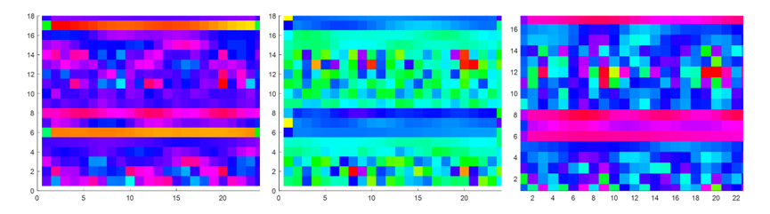
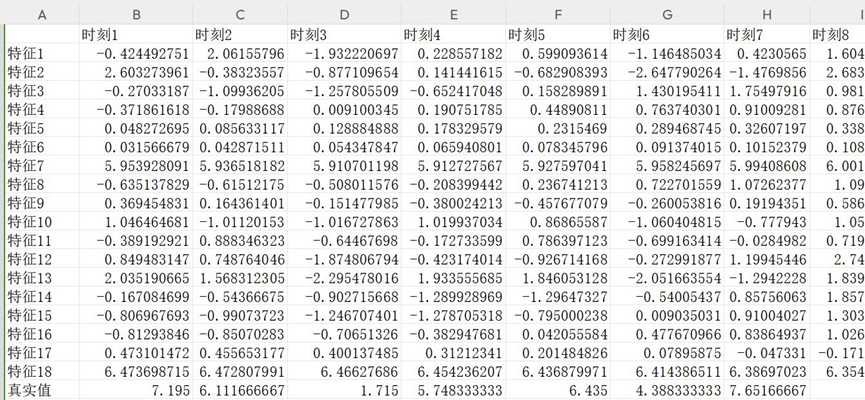

# CNN-GRU-Attention based on Convolutional Neural Network and Gated Recurrent Units with Attention Mechanism for Multivariate Regression Prediction, MATLAB Program

Applicable Platform: MATLAB 2023 and above
CNN-GRU-Attention Attention Mechanism Multivariate Time Series Forecasting Algorithm, a multivariate regression forecasting MATLAB program based on convolutional neural network and Gated Recurrent Unit (GRU) networks combined with attention mechanism.
Inputs are multivariate features, outputs are single sequence variables, provides training feature maps for a certain layer, realizes feature visualization, inputs the features of the previous day to make predictions for the next day, and provides predictive results for 24 steps ahead. Suitable for wind speed prediction, photovoltaic power prediction, power generation prediction, offshore wind power prediction, carbon price prediction, etc.
Read from an Excel table directly by replacing data, no need to make significant changes to the program. The program contains detailed comments for easy understanding of the program's operation.
Comparison between predicted values and actual values:
Visualization of features extracted by convolutional layers:
Data format: The multivariate regression forecasting program is as follows: input the 18 meteorological features of the previous day at 24-hour sampling intervals, outputting the power output for the next day at 24 hours, which means 18×24 input, 1×24 output, totaling 75 such samples.

## Images

<!-- PAYMENT_BLOCK -->

## Get this dataset

- Payment link (Stripe): [Buy now](https://buy.stripe.com/3cs8yP7sY87d0vu9AB)
- Payment QR code: 

<!-- /PAYMENT_BLOCK -->
